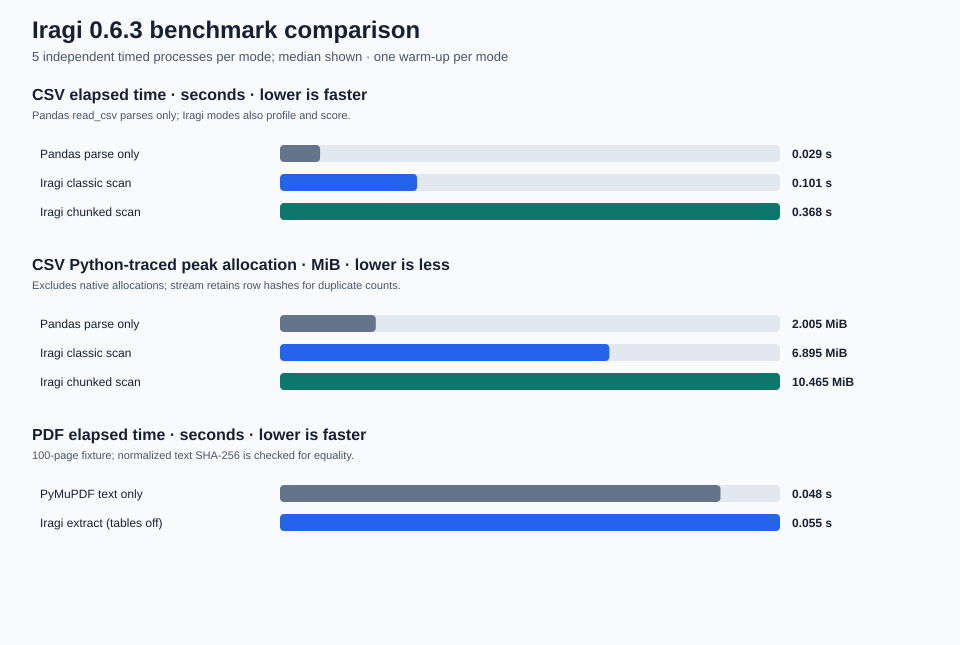
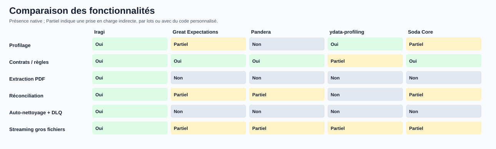
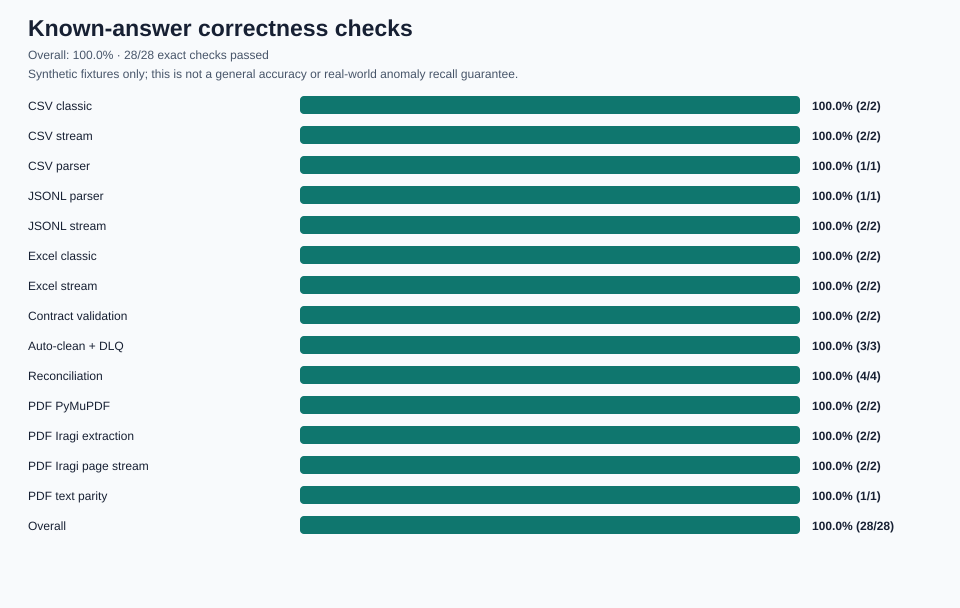

# Iragi

<p align="center">
  <a href="https://github.com/YannickMagayane/iragi/blob/main/README.md">🇬🇧 Read in English</a> &nbsp;|&nbsp; <strong>🇫🇷 Français</strong>
</p>

<p align="center">
  <strong>Inspecter. Extraire. Analyser.</strong><br>
  <em>Toolkit Python modulaire pour l'inspection de qualité de données et l'extraction de documents.</em>
</p>

<p align="center">
  <a href="https://github.com/YannickMagayane/iragi"></a>
  <a href="https://pypi.org/project/iragi/"></a>
  <a href="https://pypi.org/project/iragi/"></a>
  <a href="https://github.com/YannickMagayane/iragi/blob/main/LICENSE"></a>
  <a href="https://pepy.tech/project/iragi"></a>
  <a href="https://github.com/YannickMagayane/iragi/actions"></a>
  <a href="https://codecov.io/gh/YannickMagayane/iragi"></a>
  <a href="https://github.com/YannickMagayane/iragi/tree/main/docs/source"></a>
</p>

---

**Iragi** est un package Python modulaire dédié à l'inspection, à l'extraction et à l'analyse de fichiers. Il réunit deux moteurs indépendants — **Scan** et **PDF** — et propose un troisième module, **All**, qui orchestre leur fonctionnement dans un pipeline unifié.

L'objectif est de fournir une bibliothèque réutilisable dans des scripts Python, des applications Django ou FastAPI, des outils Data et des workflows d'automatisation, tout en offrant une interface en ligne de commande (CLI) simple et puissante.

> **Principe de conception clé :** chaque moteur doit pouvoir être utilisé seul. Le module `iragi.all` coordonne les moteurs existants sans recopier leur logique métier.

---

## Sommaire

- [Objectifs](#objectifs)
- [Fonctionnalités](#fonctionnalités)
  - [1. iragi.scan — Inspection et qualité](#1-iragiscan--inspection-et-qualité-des-fichiers)
  - [2. iragi.pdf — Extraction documentaire & streaming](#2-iragipdf--extraction-de-documents-pdf)
  - [3. iragi.reconcile — Réconciliation et rapprochement inter-sources](#3-iragireconcile--réconciliation-et-rapprochement-inter-sources)
  - [4. iragi.all — Orchestration et pipeline](#4-iragiall--orchestration-des-moteurs)
- [Architecture modulaire](#architecture-modulaire)
- [Installation](#installation)
- [Utilisation en Python](#utilisation-en-python)
  - [Inspection avec Scan](#inspection-dun-fichier-avec-scan)
  - [Extraction PDF](#extraction-dun-pdf)
  - [Pipeline unifié avec All](#analyse-combinée-avec-all)
- [Contrats de données — Règles métier & anti-ReDoS](#contrats-de-données--règles-métier-et-protection-anti-redos)
- [Remédiation déterministe & File de rejet (DLQ)](#remédiation-déterministe--file-de-rejet-dlq-iragiauto_clean)
- [Réconciliation inter-sources & normalisation Regex](#réconciliation-inter-sources--normalisation-regex-iragireconcile)
- [Réconciliation multi-sources par consensus](#réconciliation-multi-sources-par-consensus-iragireconcile_multi)
- [Traitement par blocs des gros fichiers (CSV, Excel, PDF)](#traitement-par-blocs-des-gros-fichiers-csv-excel-pdf)
- [Interface CLI](#interface-cli)
- [Benchmarks](#benchmarks)
- [Rapports](#rapports)
- [Documentation Sphinx](#documentation-sphinx)
- [Architecture du projet](#architecture-du-projet)
- [Socle technologique & Potentiel](#socle-technologique--fort-potentiel)
- [Principes de conception](#principes-de-conception)
- [Contribution](#contribution)
- [Licence](#licence)

---

## Objectifs

Iragi vise à simplifier trois opérations fréquentes dans les projets logiciels et Data :

1. **Inspecter des fichiers** pour comprendre leur structure, leur contenu et leur qualité.
2. **Extraire des informations de documents PDF**, notamment le texte, les tableaux et les métadonnées.
3. **Enchaîner extraction et contrôle qualité** afin de produire un résultat exploitable et un rapport cohérent.

Iragi n'est pas conçu comme une application web autonome. C'est d'abord un **package Python**, avec une CLI intégrée. Il doit pouvoir être incorporé à d'autres applications sans imposer un framework particulier (Django, FastAPI, Flask, notebooks ou scripts autonomes).

---

## Fonctionnalités

### 1. `iragi.scan` — Inspection et qualité des fichiers

Le moteur Scan analyse les fichiers structurés ou textuels afin d'en comprendre le contenu et de détecter les anomalies et problèmes courants de qualité.

**Formats ciblés :**
- **CSV** (séparateurs automatiques, encodages variés)
- **Excel** (`.xlsx`, `.xls` selon dépendances)
- **JSON** (objets, tableaux tabulaires, JSON Lines)
- **TXT** et logs techniques
- Autres formats tabulaires ajoutés progressivement

**Capacités principales :**
- **Détection de format** et lecture intelligente du fichier.
- **Inspection structurelle :** comptage des lignes, colonnes, feuilles et types de données.
- **Profilage des colonnes :** détection des types inférés, unicité, cardinalité.
- **Contrôle de complétude :** valeurs manquantes, vides ou nulles.
- **Détection des doublons :** lignes redondantes ou quasi-doublons.
- **Détection des types incohérents :** formats de dates invalides, anomalies numériques (y compris colonnes de prix formatées).
- **Repérage d'anomalies statistiques :** outliers via méthode IQR et **Modified Z-Score** (médiane et MAD) pour données asymétriques (Pareto, Poisson).
- **Score indicatif de qualité :** score pondéré sur 100 avec pénalités transparentes, pénalisation automatique des colonnes 100% vides et protection anti-dilution sur les colonnes critiques.
- **Contrats de données (`DataContract`) :** déclarez et appliquez des règles métier par colonne (`not_null`, `positive`, `range`, `regex` avec **protection anti-ReDoS**).
- **Nettoyage automatique (`auto_clean`) :** remédiation non destructive (déduplication, imputation moyenne/médiane numérique, imputation mode catégorielle).
- **Détection de dérive (`compare_scans`) :** comparaison de deux scans dans le temps pour identifier les dérives statistiques de qualité.
- **Traitement par blocs (`scan_csv_stream`, `scan_excel_stream`, `scan_jsonl_stream`) :** lecture des CSV, Excel et JSON Lines par blocs. Le comptage des doublons conserve les empreintes des lignes distinctes en mémoire et le score statistique est estimatif.
- **Protections d’entrée :** assainissement optionnel des formules CSV, analyse XML renforcée et limites de taille et de compression des archives de feuilles de calcul.

### 2. `iragi.pdf` — Extraction de documents PDF

Le moteur PDF se concentre sur l'extraction, la structuration et la numérisation du contenu des documents PDF.

**Capacités principales :**
- **Extraction textuelle :** flux de texte structuré par page, paragraphe et bloc.
- **Extraction tabulaire :** extraction et conversion directe des grilles de données tabulaires vers des DataFrames / CSV.
- **Métadonnées :** titre, auteur, date de création, producteur, nombre de pages.
- **Traitement par lots (Batch) :** traitement efficace de répertoires de PDF entiers.
- **Détection des pages scannées :** identification automatique des pages nécessitant une reconnaissance optique.
- **OCR facultatif :** reconnaissance optique de caractères pour documents numérisés via Tesseract.
- **Exports multi-formats :** exports directs en JSON, CSV, Excel ou Markdown.
- **Parcours par page (`iter_pdf_pages`, `extract_tables_stream`) :** accès incrémental aux pages ; la mémoire réellement utilisée dépend aussi de l'extraction et du traitement en aval.

### 3. `iragi.reconcile` — Réconciliation et rapprochement inter-sources

Le moteur de réconciliation permet de croiser et rapprocher deux sources de données hétérogènes (CSV, Excel ou tableaux extraits de PDF) :
- **Rapprochement par clé :** jointure et appariement sur identifiants simples ou composites.
- **Identification des orphelins :** extraction immédiate des enregistrements présents dans la source A mais absents de B (et inversement).
- **Détection des conflits de valeurs :** identification colonne par colonne des désaccords sur les lignes appariées.
- **Taux de rapprochement :** calcul du pourcentage exact d'alignement des sources.

### 4. `iragi.all` — Orchestration des moteurs

Le module All combine les moteurs Scan et PDF dans un pipeline unifié et cohérent.

**Workflow type :**
1. Réception d'un document PDF (e.g. facture, relevé, rapport d'audit).
2. Extraction du texte, des métadonnées et des tableaux via `iragi.pdf`.
3. Structuration des données tabulaires extraites en objets intermédiaires.
4. Transmission automatique de ces données au moteur `iragi.scan`.
5. Audit de conformité et calcul du score de qualité des données extraites.
6. Génération d'un rapport consolidé traçable (JSON, HTML ou console).

**Nouveautés v0.4.0 :**
- **Audit multi-onglets Excel :** `batch_analyze([...], excel_all_sheets=True)` analyse chaque onglet d'un classeur indépendamment, au lieu de ne lire que le premier.
- **Gestion des erreurs tracée :** les fichiers en erreur dans un lot produisent un résultat explicite (`success=False`, `error=...`) au lieu d'être silencieusement ignorés.

---

## Architecture modulaire

Les trois modules sont conçus pour être importés et exécutés en toute indépendance.

| Module | Responsabilité | Utilisation autonome | Dépendances spécifiques |
|---|---|---|---|
| `iragi.scan` | Inspection et qualité des fichiers | **Oui** | `pandas`, `openpyxl` |
| `iragi.pdf` | Extraction de texte, tables et OCR | **Oui** | `pypdf`, `pdfplumber`, `pytesseract` (opt) |
| `iragi.all` | Orchestration et pipeline combiné | **Oui** | scan + pdf |

Cette séparation offre des avantages concrets :
- Intégrer `iragi.scan` dans un projet Django existant sans installer les dépendances PDF lourdes.
- Employer `iragi.pdf` dans un simple script de conversion documentaire.
- Tirer parti de `iragi.all` pour bâtir des pipelines de données bout-en-bout.
- Tester et faire évoluer chaque moteur de manière isolée.

---

## Installation

Iragi propose une installation minimale ultra-légère complétée par des extras optionnels :

```bash
# Installation minimale (moteur Scan seul)
pip install iragi

# Installation avec le moteur PDF
pip install "iragi[pdf]"

# Installation avec le support OCR pour documents scannés
pip install "iragi[ocr]"

# Installation complète (Scan + PDF + OCR + CLI complète)
pip install "iragi[all]"
```

L’extra `pdf` installe [PyMuPDF](https://github.com/pymupdf/PyMuPDF), proposé sous AGPL-3.0 ou sous licence commerciale distincte. Consultez ses [conditions de licence](https://pymupdf.readthedocs.io/en/latest/about.html#license-and-copyright) avant toute distribution.

---

## Utilisation en Python

Un notebook prêt à exécuter est disponible dans [examples/quickstart.ipynb](https://github.com/YannickMagayane/iragi/blob/main/examples/quickstart.ipynb).

### Inspection d'un fichier avec Scan

```python
from iragi.core.models import DataInspectionResult
from iragi import scan

# Inspection d'un fichier tabulaire
result: DataInspectionResult = scan("clients.csv")

# Affichage des métriques clés
print(f"Lignes : {result.row_count}, Colonnes : {result.column_count}")
print(f"Score de qualité : {result.quality_score.total_score}/100")
print("Recommandations :", result.recommendations)

# Parcours des colonnes profilées
for col in result.column_profiles:
    print(f"- {col.name} ({col.inferred_type}) : {col.missing_count} valeurs manquantes")
```

### Extraction d'un PDF

```python
from iragi.pdf import extract, extract_tables

# Extraction du document et de ses métadonnées
document = extract("rapport_annuel.pdf")
print("Titre :", document.metadata.get("title"))
print("Pages :", len(document.pages))

# Extraction des tableaux sous forme tabulaire
tables = extract_tables("rapport_annuel.pdf")
for idx, table in enumerate(tables):
    print(f"Tableau #{idx + 1} ({len(table.rows)} lignes)")
```

### Analyse combinée avec All

```python
from iragi import analyze

# Pipeline unifié extraction + audit de qualité
result = analyze("factures_q3.pdf")

print("Score de qualité global :", result.quality_report.quality_score.total_score)
print("Données tabulaires extraites :", len(result.extracted_data.tables))
print("Anomalies détectées :", result.quality_report.potential_outliers_count)
```

---

## Contrats de données — Règles métier et protection anti-ReDoS

Déclarez et appliquez des règles strictes sur vos colonnes (présence, positivité, intervalle numérique ou conformité d'expression régulière avec coupe-circuit anti-ReDoS) :

```python
import iragi
import pandas as pd

df = pd.read_csv("factures.csv")

contract = (
    iragi.DataContract()
    .require_not_null("reference_facture")
    .require_positive("montant_ht")
    .require_range("taux_tva", min_val=0, max_val=100)
    .require_regex("email_contact", r"^[^@]+@[^@]+\.[^@]+$")
)

violations = iragi.validate_contract(df, contract)
for v in violations:
    print(f"[{v.rule}] Colonne '{v.column}' : {v.detail} ({v.failed_count} lignes en anomalie)")
```

---

## Remédiation déterministe & File de rejet (DLQ) (`iragi.auto_clean`)

L'imputation statistique aveugle (remplacer les vides par la moyenne) altère gravement les données financières calculées (`Montant_Net = (Prix * Unites) * (1 - Remise) + Frais`). Iragi propose des formules de calcul déterministes et isole les violations de contrat dans une file de rejet (**Dead-Letter Queue**) :

```python
import iragi
import pandas as pd

df = pd.read_csv("commandes.csv")

contract = (
    iragi.DataContract()
    .require_positive("montant_net")
    .require_regex("statut", r"^(PAYE|ECHOUE)$")
)

res = iragi.auto_clean(
    df,
    drop_duplicates=True,
    fuzzy_dedup=True,
    fuzzy_columns=["client"],
    # Formule mathématique exacte au lieu d'une moyenne statistique aveugle
    computed_columns={
        "montant_net": lambda d: (d["prix_unitaire"] * d["unites"]) * (1.0 - d["remise"]) + d["frais_port"]
    },
    exclude_columns=["id_confidentiel"],
    contract=contract,
    contract_action="quarantine",  # Isole les anomalies dans la Dead-Letter Queue
)

clean_df = res.df
dlq_df = res.quarantine_df

print(f"Lignes saines validées : {len(clean_df)}")
print(f"Lignes corrompues isolées en DLQ : {len(dlq_df)}")
print("Audit des modifications :", res.changes)
```

---

## Réconciliation inter-sources & normalisation Regex (`iragi.reconcile`)

Rapprochez des données provenant de deux systèmes différents même si les colonnes portent des noms distincts ou comportent des préfixes hétérogènes (`TRX-101` côté Ventes vs `FACT_101` côté Finance) :

```python
import iragi
import pandas as pd

df_ventes = pd.read_csv("ventes.csv")
df_finance = pd.read_excel("finance.xlsx")

# Rapprochement avec normalisation Regex pour isoler le numéro de séquence
result = iragi.reconcile(
    df_ventes,
    df_finance,
    on=("numero_commande", "reference_facture"),
    key_transform=r"(\d+)",
    compare_columns=["montant"],
)

print(f"Taux de rapprochement : {result.match_rate * 100:.2f}%")
print(f"Enregistrements appariés : {result.matched_count}")
print(f"Orphelins Ventes uniquement : {result.orphan_a_count}")
print(f"Orphelins Finance uniquement : {result.orphan_b_count}")
print(f"Écarts de montants constatés : {result.conflict_columns.get('montant', 0)}")
```

---

## Réconciliation multi-sources par consensus (`iragi.reconcile_multi`)

Croisez 3 sources ou plus simultanément pour mesurer le consensus global :

```python
import iragi

res = iragi.reconcile_multi(
    {"ventes": df_ventes, "logistique": df_logistique, "comptabilite": df_compta},
    on="id_reference",
    key_transform=lambda k: "".join(filter(str.isdigit, str(k))),
)

print(f"Clés validées en consensus complet : {res.all_matched_count}")
print(f"Total des clés uniques : {res.total_unique_keys}")
print(f"Taux de consensus : {res.consensus_match_rate * 100:.2f}%")
print(f"Orphelins par système : {res.orphans_by_source}")
```

---

## Traitement par blocs des gros fichiers (CSV, Excel, PDF)

Les lecteurs CSV, Excel et JSON Lines peuvent traiter les entrées par blocs. Les scans en streaming conservent les empreintes des lignes distinctes et estiment les statistiques à partir d’échantillons; leur score est marqué comme estimatif. Les itérateurs PDF renvoient les résultats au fil de la lecture.

```python
import iragi
from iragi.scan import scan_csv_stream, scan_excel_stream
from iragi.pdf import iter_pdf_pages, extract_tables_stream

# 1. Audit en streaming d'un CSV géant (50 Go+) par blocs de 50 000 lignes
res_csv = scan_csv_stream("gros_fichier.csv", chunksize=50_000)
print(f"Score CSV : {res_csv.quality_score.total_score:.1f}/100")

# 2. Audit d'un classeur Excel volumineux sans gonfler la RAM (mode streaming read_only)
res_excel = scan_excel_stream("classeur_lourd.xlsx", sheet_name="01_Ventes", chunksize=25_000)
print(f"Score Excel : {res_excel.quality_score.total_score:.1f}/100")

# 3. Parcours page par page d'un PDF de plusieurs milliers de pages
for page in iter_pdf_pages("document_volumineux.pdf", batch_size=10):
    if page.is_scanned:
        print(f"Page {page.page_number} identifiée comme scan papier")

# 4. Extraction de tableaux PDF en flux continu (générateur)
for table in extract_tables_stream("document_volumineux.pdf"):
    df_table = table.to_dataframe()
    # Ingestion immédiate dans la base de données
```

---

## Interface CLI

Iragi dispose d'une interface en ligne de commande moderne et intuitive construite avec `typer` et mise en forme avec `rich`.

```bash
# Inspection de fichiers locaux
iragi scan data.csv
iragi scan data.xlsx --sheet "Ventes"
iragi scan data.json --output report.json

# Inspection directe d'un fichier distant via URL
iragi scan https://data.gov/resources/air_quality_annual.csv

# Extraction PDF
iragi pdf text document.pdf
iragi pdf tables document.pdf --format csv --output ./tables/
iragi pdf metadata document.pdf

# Pipeline complet sur un fichier distant
iragi all https://www.insee.fr/en/statistiques/fichier/emploi_2026.xlsx
iragi all document.pdf --report html --output ./reports/audit.html
```

---

## Ingestion de fichiers distants et cloud

Iragi accepte les URL HTTP ou HTTPS partout où un chemin de fichier local est attendu. Les requêtes distantes refusent les adresses IP privées ou non routables, suivent au plus cinq redirections validées et peuvent être restreintes avec `allowed_hosts`.
Aucune configuration n'est necessaire. Les fichiers sont telecharges de maniere transparente, analyses en memoire,
et une copie temporaire est utilisée pour l'analyse. Les parcours de haut niveau la suppriment après traitement ; si un téléchargement est fait via l'API de bas niveau, l'appelant gère le fichier retourné.

### Sources prises en charge

- **Portails Open Data :** data.gov, data.world, Kaggle, INSEE, OMS, Eurostat
- **Stockage cloud :** URLs presignees AWS S3, Google Cloud Storage, Azure Blob Storage
- **Tout lien de telechargement direct :** jeux de donnees de recherche, rapports financiers, telemetrie capteurs

### Exemples

```python
import iragi

# Inspecter un CSV directement depuis un portail de donnees ouvertes
result = iragi.scan("https://data.gov/resources/air_quality_annual.csv")
print(f"Lignes : {result.row_count}, Score : {result.quality_score.total_score}/100")

# Inspecter un fichier Parquet depuis Google Cloud Storage
result = iragi.scan("https://storage.googleapis.com/climate/co2_monitoring.parquet")
print(f"Colonnes : {result.columns}")

# Analyse unifiee complete sur un rapport Excel gouvernemental distant
res = iragi.analyze("https://www.insee.fr/en/statistiques/fichier/emploi_2026.xlsx")
print(f"Type de fichier : {res.file_type}, Score : {res.overall_quality_score}/100")

# Analyse en lot d'un mix de fichiers locaux et distants (tout type, tout domaine)
results = iragi.batch_analyze([
    "donnees_locales/ventes_internes.csv",
    "https://opendata.health.org/essais_cliniques.parquet",
    "https://s3.amazonaws.com/mybucket/logistique/expeditions.xlsx",
    "https://ftp.gov.org/archive/population_2026.json",
])
for r in results:
    print(f"{r.file_path} : {r.overall_quality_score}/100")
```

### Limites des entrées distantes et nettoyage

| Protection | Valeur par defaut |
|---|---|
| Taille maximale du fichier | 500 Mo (configurable via l'API de téléchargement bas niveau) |
| Timeout reseau | 30 secondes |
| Nombre maximal de redirections | 5, avec validation à chaque étape |
| Fichier temporaire | Supprimé par les parcours scan/analyze ; l'appelant de `fetch_remote_file` gère le chemin retourné |

Les objets privés S3 et GCS nécessitent une URL présignée. La validation de l'hôte limite l'accès aux adresses locales et privées, mais ne remplace pas les règles de sortie réseau de l'environnement de déploiement. La limite de 500 Mo se configure via l'API de téléchargement de bas niveau ; son appelant doit supprimer le fichier temporaire retourné.

---

## Rapports

Iragi permet d'exporter les résultats dans différents formats pour convenir à tous les usages :

- **JSON :** Structure complète sérialisable pour pipelines CI/CD, APIs REST ou Django/FastAPI.
- **HTML :** Rapports interactifs lisibles dans un navigateur, avec graphiques et tableaux clairs.
- **CSV / Excel :** Export direct des données extraites ou nettoyées.

Les rapports peuvent inclure l'empreinte du fichier source, l'heure d'analyse, les paramètres et les pénalités du score de qualité, selon le format et le parcours utilisés.

---

## Documentation Sphinx

La documentation technique est générée automatiquement à partir des docstrings au format Sphinx.

### Génération locale

Pour générer la documentation HTML du projet :

```bash
# Génération standard
bin/docs

# Nettoyage et régénération complète
bin/docs --clean -E -a
```

La documentation compilée est générée dans `docs/build/html/index.html`.

---

## Benchmarks

Le banc d'essai couvre le scan et plusieurs autres fonctions : CSV et JSON Lines de 100 000 lignes, classeur Excel de 25 000 lignes, extraction et parcours d'un PDF de 100 pages, validation de contrats, auto-nettoyage avec quarantaine DLQ et réconciliation de deux sources. Chaque mode reçoit un échauffement puis cinq mesures dans des processus séparés. Le rapport conserve médianes, plages min/max, mesures brutes, nombres de doublons et allocation maximale suivie par Python. Les entrées partagées par une opération sont chargées avant le chronométrage ; le JSON indique les tailles précises des fixtures et l'environnement.







Le score d'exactitude sur données synthétiques est de **100 % (28 contrôles sur 28)** pour cette exécution. Il vérifie des nombres de lignes et de doublons attendus, les échecs de règles, la quarantaine, la réconciliation, les marqueurs des pages PDF et l'égalité du texte normalisé. Ce résultat limité à des fixtures connues ne mesure ni l'exactitude générale, ni le rappel d'anomalies en production, ni la validité du score de qualité pondéré d'Iragi. Les autres outils n'ont pas été installés ou exécutés : aucun score d'exactitude ni temps ne leur est attribué.

| Fonctionnalité | Iragi | Great Expectations | Pandera | ydata-profiling | Soda Core |
| --- | --- | --- | --- | --- | --- |
| Profilage | Oui | Partiel | Non | Oui | Partiel |
| Contrats / règles | Oui | Oui | Oui | Partiel | Oui |
| Extraction PDF | Oui | Non | Non | Non | Non |
| Réconciliation | Oui | Partiel (personnalisable) | Partiel (personnalisable) | Non | Partiel (références) |
| Auto-nettoyage + DLQ | Oui | Non | Non | Non | Non |
| Streaming gros fichiers | Oui | Partiel (lots / Spark) | Partiel (par blocs) | Partiel (échantillonnage / Spark) | Partiel (selon la source) |

« Partiel » signifie que la capacité demande du code personnalisé, un traitement par lots, un échantillonnage ou une source externe prise en charge ; ce tableau ne compare pas des performances équivalentes. Les flux par lots et Spark de Great Expectations, la validation de schémas Pandera, le guide grands volumes de ydata-profiling et les contrôles par source de Soda sont décrits dans leurs documentations [officielles](https://docs.greatexpectations.io/docs/core/introduction/gx_overview/), [Pandera](https://pandera.readthedocs.io/en/stable/), [YData](https://docs.profiling.ydata.ai/latest/features/big_data/) et [Soda Core](https://docs.soda.io/soda-documentation/soda-v3/overview-main). Les durées réellement mesurées ici concernent Iragi et les parseurs de référence ; les paquets concurrents optionnels n'étaient pas installés. Le traitement d'un DataFrame en mémoire avec Soda requiert aussi un adaptateur et une configuration Soda Cloud.

Les [résultats bruts](https://github.com/YannickMagayane/iragi/blob/main/benchmarks/results.json) décrivent la machine consignée. La mesure Python exclut les allocations natives de pandas/NumPy et ne représente pas la mémoire totale du processus. Les durées dépendent du matériel et des données.

Sur cette machine et ces fixtures, l'avantage mesuré d'Iragi est la réunion de plusieurs fonctions dans un même package : profilage, contrats, extraction PDF, réconciliation et nettoyage avec quarantaine. Les mesures ne montrent **pas** de gain général de vitesse : les scans CSV sont plus lents que le parsing seul par pandas, car ils profilent aussi les données, calculent un score et comptent les doublons ; l'extraction PDF est environ 45 fois plus lente que l'extraction textuelle directe avec PyMuPDF. Le streaming JSON Lines utilise environ 81 % moins d'allocation maximale suivie par Python que la lecture JSONL complète par pandas, mais prend environ 21 % plus de temps. Le streaming Excel est environ 7 % plus rapide que le scan Excel complet d'Iragi dans cette exécution. Ces comparaisons couvrent des opérations différentes ou une seule machine et fixture ; elles ne garantissent pas les mêmes résultats ailleurs.

Pour reproduire le benchmark :

```bash
python bench_suite.py --rows 100000 --excel-rows 25000 --reconcile-rows 10000 \
  --chunksize 10000 --repeat 5
```

Cette commande génère les résultats JSON, le graphique des charges mesurées et les matrices de fonctionnalités anglaise et française dans `benchmarks/`.

Elle génère aussi `benchmarks/accuracy.svg`, qui représente les contrôles d'exactitude sur les résultats attendus des fixtures.

La CI exécute pytest. Les commandes `bin/docs`, `python -m build` et `python -m twine check dist/*` compilent localement la documentation et les artefacts de distribution.

---

## Architecture du projet

```text
iragi/
  core/       configuration, modèles, erreurs et entrées distantes
  scan/       lecteurs, profilage, contrats, nettoyage, dérive et rapports
  pdf/        extraction, tableaux, outils OCR et modèles
  reconcile/  rapprochement inter-sources et détection des conflits
  all/        orchestration des analyses combinées
  cli/        interface en ligne de commande
tests/        tests automatisés
examples/     exemples et notebooks
benchmarks/   outil reproductible, résultats bruts et graphiques
docs/source/  documentation Sphinx
bin/          outils de génération de la documentation
bench_suite.py
pyproject.toml
CHANGELOG.md
```

Les API publiques sont réparties entre `scan`, `pdf` et `reconcile` ; `all` coordonne ces modules. Cette arborescence suit les sources présentes dans le dépôt. Les mesures et la CI aident à reproduire les vérifications, sans constituer un engagement de niveau de service.

---

## Socle technologique & Fort Potentiel

Iragi s’appuie sur une pile Python courante pour l’inspection tabulaire, l’extraction PDF et la génération de rapports :

- **Inspection tabulaire :** **Python 3.10+**, **Pandas 2+** et **NumPy** pour le profilage, les règles de qualité, les doublons et les statistiques descriptives.
- **Extraction PDF :** **PyMuPDF** pour le texte et les métadonnées, **pdfplumber** pour les tableaux et Tesseract/Pillow pour l’OCR facultatif.
- **Expérience développeur & Interface riche :** Une CLI moderne et fluide animée par **Typer** et **Rich**, offrant des diagnostics visuels colorés et lisibles directement dans votre terminal sans configuration préalable.
- **Rapports & Restitution dynamique :** Moteur de templating **Jinja2** permettant la génération instantanée de synthèses JSON ou de rapports HTML exploitables par les décideurs métiers.
- **Vérifications :** GitHub Actions exécute les tests sur Python 3.10–3.13 et pandas 2.x/3.x, sous Linux et Windows. Le transfert de couverture Codecov est activé uniquement si `CODECOV_TOKEN` est configuré.

### Cas d'utilisation

Grâce à son architecture découplée et composable, **Iragi s'intègre en quelques lignes de code** au cœur de vos projets stratégiques :
- **Pipelines ETL & Data Lakes :** Validation automatique des schémas et de la qualité des données avant ingestion dans vos entrepôts.
- **Applications Web & Microservices (Django / FastAPI) :** Analyse à la volée des uploads utilisateurs avec retour immédiat sur la conformité des fichiers.
- **Pipelines de recherche et RAG :** Préparation et extraction de documents tabulaires ou PDF avant indexation ; les résultats dépendent des données et des règles définies.

---

## Principes de conception

1. **Modularité stricte :** Scan, PDF et All ont des responsabilités distinctes et des cycles de vie indépendants.
2. **Priorité à l'API Python :** La CLI n'est qu'un client léger consommant les modules Python publics.
3. **Indépendance vis-à-vis des frameworks :** Utilisable nativement dans un script, Django, FastAPI ou Jupyter.
4. **Immuabilité des données sources :** Aucune modification destructive par défaut.
5. **Score explicable et traçable :** Tout score de qualité expose la formule et les pénalités appliquées.
6. **Gestion explicite des erreurs :** Aucune exception masquée silencieusement.
7. **Dépendances optionnelles :** Un utilisateur de `iragi.scan` ne télécharge pas les dépendances de rendu PDF ou OCR.
8. **Documentation maintenue :** La documentation Sphinx décrit les API publiques et les principaux parcours ; la couverture des docstrings varie selon les modules.

---

## Contribution

Les contributions sont les bienvenues ! Pour proposer une fonctionnalité ou un correctif :

1. Ouvrez une issue pour échanger sur la conception et l'intérêt de la modification.
2. Respectez l'isolation stricte entre moteurs et les conventions de docstrings Sphinx.
3. Ajoutez les tests correspondants sous `tests/`.
4. Vérifiez que la documentation se génère sans avertissement (`bin/docs`).

---

## Licence

Ce projet est distribué sous licence [MIT](https://github.com/YannickMagayane/iragi/blob/main/LICENSE).

---

<p align="center">
  <strong>Iragi — Inspecter. Extraire. Analyser.</strong>
</p>
